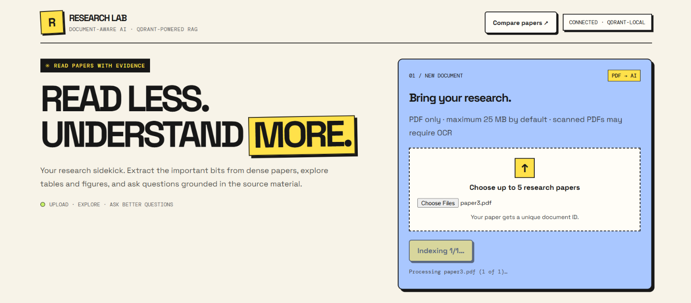

# ResearchLab — Static Showcase Website

This folder contains a **static portfolio/showcase website** for [Research Paper Assistant](https://github.com/kartiktomar03/Research-Paper-Assistant). It does **not** run the Flask/Groq/Qdrant backend. The actual research application remains in the main project repository, which supports both local Qdrant and Qdrant Cloud.

## Publish with GitHub Pages (recommended)

1. In your **existing** `Research-Paper-Assistant` repository, create a root `docs/` directory.
2. Copy **all contents of this package's `docs/` folder** into that repository's `docs/` folder, preserving `assets/researchlab-app.png`.
3. Run:
   ```bash
   git add docs
   git commit -m "feat: add ResearchLab project showcase website"
   git push origin main
   ```
4. On GitHub, open the repository **Settings → Pages → Build and deployment**, choose **Deploy from a branch**, select **main**, select **/docs**, and save.
5. Website URL should be: `https://kartiktomar03.github.io/Research-Paper-Assistant/` once GitHub Pages reports successful publication.

Alternatively, upload `docs/` to any static hosting provider.

## Add a real demo video later

Record a 1–3 minute walkthrough of your **working localhost app** (PDF upload, extraction, summary/Q&A, comparison). Place a browser-playable MP4 at `docs/assets/demo.mp4` and push it. The static site will automatically show the video player instead of the preview placeholder. No fake video is included. Keep it short to avoid large Git commits.

## Add your four screenshots

The **Workspace in Action** window contains four clearly labeled placeholders. Capture these views from your working local app:

1. Upload & Index
2. Single Paper Q&A
3. Tables & Figures
4. Compare Papers

Save screenshots under `docs/assets/` as `screenshot-1.png` through `screenshot-4.png`.

In `docs/index.html`, find the corresponding `workspace-shot` block. Replace only its `workspace-placeholder` element with:

```html

```

Use the matching number/description for the other three screenshots. The gallery layout and hover effects stay intact. The original `researchlab-app.png` remains in `assets/` for the optional demo video poster; it is no longer used as the large showcase screenshot.

## Existing deployment and credentials

You may stop/delete the old Render service independently; **do not delete Qdrant Cloud settings from your repository** just to publish this showcase. Keep `.env` and all credentials out of Git and GitHub Pages. Static-site visitors cannot run Flask/RAG within GitHub Pages; they can follow your repository setup instructions to run locally.
